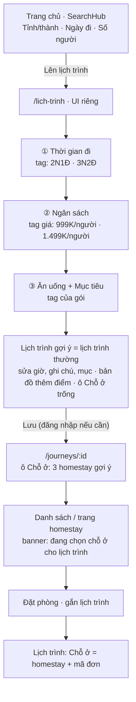

# Lịch trình gợi ý — phân tích và kế hoạch triển khai (phase 1)

Ngày 11/10/2026. Nguồn: yêu cầu ngày 11/10 và hai file `docs/Lịch trình 2n1d mù cang chải.docx`, `docs/Lịch trình 3N2d.docx`. Đọc kèm `docs/db-v2.md` (quy ước DB). Làm trên nhánh tách từ `db-v2` (cần schema v2).

Đã chốt ngày 11/10: **không dùng giá tham khảo** — mốc giá trong docx (999K, 1.499K / người) là **một tag lọc**; lịch trình gợi ý chỉ là **lịch trình bình thường đã lọc sẵn**, khách sửa tiếp được; ô điểm đến có **dòng phụ** (vùng nổi bật); **bản đồ lên lịch trình bỏ khỏi trang homestay, chuyển sang trang tạo lịch trình**.

- [0. Tóm tắt](#0-tóm-tắt)
- [1. Hiện trạng](#1-hiện-trạng)
- [2. Phân tích hai gói lịch trình](#2-phân-tích-hai-gói-lịch-trình)
- [3. Luồng mới](#3-luồng-mới)
- [4. Thiết kế từng phần](#4-thiết-kế-từng-phần)
- [5. Dữ liệu](#5-dữ-liệu)
- [6. API](#6-api)
- [7. Frontend: tệp mới và tệp sửa](#7-frontend-tệp-mới-và-tệp-sửa)
- [8. Thứ tự triển khai](#8-thứ-tự-triển-khai)
- [9. Nghiệm thu](#9-nghiệm-thu)
- [10. Để sang phase 2](#10-để-sang-phase-2)
- [11. Quyết định và việc còn mở](#11-quyết-định-và-việc-còn-mở)
- [12. Kết quả triển khai phase 1](#12-kết-quả-triển-khai-phase-1)
- [Phụ lục A. Nội dung hai gói mẫu](#phụ-lục-a-nội-dung-hai-gói-mẫu)
- [13. Phase 2: gộp dữ liệu lịch trình](#13-phase-2-gộp-dữ-liệu-lịch-trình)
- [14. Trang Lịch trình gộp (10/2026)](#14-trang-lịch-trình-gộp-102026)
- [15. Chọn tiêu chí thay cho chọn gói (13/10/2026)](#15-chọn-tiêu-chí-thay-cho-chọn-gói-13102026)

## 0. Tóm tắt

Đổi hướng sản phẩm: từ "chọn homestay → lên lịch trình quanh homestay" sang **"lên lịch trình trước → chọn và đặt homestay để lấp ô Chỗ ở"**.

| Hạng mục | Quyết định |
|---|---|
| SearchHub | Còn 3 ô **Điểm đến (tỉnh / thành, có dòng phụ vùng nổi bật) · Ngày đi · Số người**. Bỏ tab "Vui chơi" và cấp quận / huyện. Trang chủ: nút **"Lên lịch trình"**; trang danh sách homestay: nút "Tìm chỗ ở". |
| Gợi ý | Trang riêng `/lich-trinh`: lọc các **gói** (lịch trình mẫu từ docx) theo tag — ① Thời gian đi → ② Ngân sách (tag giá của gói, vd "1.499K/người") → ③ Ăn uống + Mục tiêu. Chọn xong một tag thì bước sau trượt vào; mỗi bước chỉ hiện tag còn khớp. Ra gói phù hợp → **mở thành lịch trình bình thường** để khách sửa (giờ, ghi chú, thêm / bỏ mục, thêm điểm trên bản đồ) rồi lưu. |
| Chỗ ở | Lịch trình có **ô "Chỗ ở"** để trống. Lưu xong gợi ý 3 homestay đúng tỉnh, ngày, số người → đặt phòng → đơn tự gắn vào lịch trình. |
| Dịch vụ | Danh mục **`trip_addon`** (xe Hà Nội – MCC, HDV bản địa, flycam, dù lượn, hỗ trợ đặt món), gắn vào từng mục như docx (flycam ở điểm ngắm cảnh). **Không có giá** — ghi đúng như docx ("giá ưu đãi riêng"); đặt dịch vụ qua tư vấn Zalo ("Inbox để nhận lịch khởi hành & giữ chỗ" trong docx). |
| Hoạt động, ăn uống | Chưa có bảng riêng. `journey_stop` mở rộng thành **mục lịch trình** có loại, giờ, tiêu đề, ghi chú, dịch vụ. Mục không phải điểm tham quan = tiêu đề + ghi chú. |
| Bản đồ | Bỏ khỏi trang homestay; nằm trên trang tạo / sửa lịch trình (`/lich-trinh`), dùng lại `PlannerMap`. |
| Khối lượng | 8 bước, mỗi bước chạy được; khoảng **13–14 ngày công** cho 1 dev full-stack. |

## 1. Hiện trạng

Đọc code nhánh `db-v2` và API công khai production ngày 11/10/2026.

| Phần | Hiện tại | Vướng với yêu cầu mới |
|---|---|---|
| SearchHub (`frontend-pwa/src/components/layout/SearchHub.tsx`, 1.715 dòng) | Ba tab: Điểm đến (tỉnh → quận / huyện), Vui chơi (điểm tham quan + nhu cầu), Ngày đi. Nút "Hành trình mới" chỉ mở `/homestays?…`. Dữ liệu dự phòng `DEFAULT_LOCATIONS` dựng sẵn huyện / xã của 7 tỉnh (6 tỉnh không có dữ liệu thật). | Bỏ cấp quận và tab vui chơi; thêm số người; nút dẫn vào lịch trình. |
| Lịch trình (`JourneyPlanner.tsx` trong `HomestayDetailPage`) | Homestay trước: chọn điểm **cùng huyện** trên bản đồ, xếp **ngày + buổi**; nháp `localStorage` theo homestay; trang đặt phòng lưu lịch trình cùng đơn; tab "Lịch trình" của đơn nhúng lại planner. | Tách khỏi trang homestay: lịch trình trước, chỗ ở sau. |
| `journey_stop` | `place_id NOT NULL`, chỉ nhận điểm tham quan công khai; chỉ có `visit_date` + `day_session`. | Không biểu diễn được giờ (05:30–06:00), bữa ăn, đêm văn hóa, di chuyển, nhận / trả phòng, dịch vụ. |
| Dữ liệu thật | 1 tỉnh (Yên Bái) → 2 huyện → 16 xã; **16 điểm tham quan**; **10 homestay** (350k–830k / phòng / đêm); **15 món đặc sản**; **0** nhà hàng, điểm văn hóa, dịch vụ, nhà xe. | Đủ cho hai gói MCC; hoạt động, bữa ăn là mục ghi chú. |

Đối chiếu điểm trong docx với dữ liệu (gói tham chiếu điểm theo **slug** — giống nhau ở production và máy dev):

| Trong docx | Dữ liệu | Xử lý |
|---|---|---|
| Đèo Khau Phạ – Lìm Mông | `deo-khau-pha` | Lìm Mông → ghi chú |
| Đồi Mâm Xôi – La Pán Tẩn | `doi-mam-xoi-la-pan-tan` | |
| Sống Lưng Khủng Long | `song-lung-khung-long-de-xu-phinh` | |
| Đồi Móng Ngựa – Võng Lúa | `doi-mong-ngua` | |
| Kim Nọi (mỏm đá cô đơn, cột cờ) | `doi-kim-noi-hang-dang-de` | |
| Rừng Trúc Háng Sung | gần nhất `rung-truc-mo-de` | **cần xác nhận** |
| Tú Lệ (ăn trưa, giã cốm) | `thung-lung-tu-le`; món `xoi-nep-tu-le-xoi-ngu-sac`, `com-tu-le-ngoc-xanh` | |
| Cá suối nướng, lợn bản nướng, gà đen Mông, xôi nếp | `ca-suoi-nuong-mu-cang-chai`, `thit-lon-ban-kep-cay-rung-nuong`, `ga-den-mu-cang-chai`, `xoi-nep-tu-le-xoi-ngu-sac` | Ảnh món trong mục ăn trưa |
| Nhà Ngô (tiêu đề ngày 2 gói 3N2Đ) | không có, lịch chi tiết không nhắc | bỏ, **cần xác nhận** |

## 2. Phân tích hai gói lịch trình

| Gói | Thời lượng | Tag giá | Đã gồm | Dịch vụ thêm |
|---|---|---|---|---|
| `MCC_2N1D` | 2 ngày 1 đêm | 999K / người | Xe Hà Nội – MCC; 1 đêm homestay trung tâm MCC | HDV bản địa; flycam (giá ưu đãi riêng); hỗ trợ đặt ăn uống đồ địa phương |
| `MCC_3N2D` | 3 ngày 2 đêm | 1.499K / người | Xe Hà Nội – MCC; 2 đêm homestay trung tâm MCC | Như trên |

Loại mục lịch trình (`kind`), suy từ các mốc giờ trong docx:

| `kind` | Ví dụ | Hiển thị | Check-in ảnh |
|---|---|---|---|
| `TRANSPORT` | 05:30 khởi hành từ Hà Nội | Icon xe, màu chàm | Không |
| `MEAL` | Ăn trưa Tú Lệ, ăn tối Tây Bắc | Icon bát đũa, màu san hô, ảnh món | Không |
| `PLACE` | Khau Phạ, Mâm Xôi, Móng Ngựa, Kim Nọi | Ảnh điểm, màu xanh lá | Có |
| `ACTIVITY` | Đêm văn hóa múa xòe, nhảy sạp; giã cốm | Icon lửa trại, màu nắng | Không |
| `STAY` | Nhận phòng; trả phòng | **Ô Chỗ ở** | Không |
| `FREE` | Về nghỉ ngơi, tắm rửa | Chữ nhỏ, xám | Không |

Tag lọc của gói lấy từ chính câu chữ docx:

| Nhóm | Tag | 2N1Đ | 3N2Đ | Nguồn trong docx |
|---|---|---|---|---|
| Ăn uống (`TRIP_DINING`) | Đặc sản địa phương | ✓ | ✓ | "Ăn trưa với đặc sản địa phương", "ẩm thực bản địa Tây Bắc" |
| | Bữa sáng ngắm bình minh | | ✓ | "Mua xôi Tú Lệ, cà phê … vừa ngắm bình minh vừa thưởng thức bữa sáng giữa núi rừng" |
| Mục tiêu (`TRIP_GOAL`) | Săn mây, bình minh | ✓ | ✓ | "Săn bình minh đồi Mâm Xôi"; "Săn mây & khám phá núi rừng" |
| | Săn lúa, ruộng bậc thang | ✓ | ✓ | "vừa săn lúa"; "Sống giữa những mùa ruộng bậc thang" |
| | Văn hóa bản địa | ✓ | ✓ | "trải nghiệm văn hóa Tây Bắc"; "Trải nghiệm văn hóa bản địa" |
| | Săn ảnh, flycam | ✓ | ✓ | "Hỗ trợ flycam lưu lại hình ảnh cho đoàn" |
| | Nhẹ nhàng, chill | ✓ | | "vừa chill" |
| | Phiêu lưu, dù lượn | | ✓ | "trải nghiệm dù lượn nếu thời tiết cho phép" |

Chỗ lệch trong docx: phần tóm tắt cuối mỗi file đảo thứ tự Mâm Xôi / Kim Nọi so với lịch chi tiết → **dùng lịch chi tiết theo giờ**. "Phòng từ 400K/người" không đưa vào lịch trình (ô Chỗ ở hiện homestay thật khách đặt).

## 3. Luồng mới



Lối vào khác: mục "Lên lịch trình" trên menu; "Chuyến đi của tôi" khi chưa có lịch trình; thẻ mời ở trang homestay (mở `/lich-trinh` với ngày, số người và homestay đó đứng đầu gợi ý chỗ ở); tab "Lịch trình" của đơn (mở `/lich-trinh` theo ngày, số khách của đơn; lưu xong tự gắn đơn).

## 4. Thiết kế từng phần

### 4.1 SearchHub

| Ô | Nội dung |
|---|---|
| Điểm đến | Tỉnh / thành (cấp 1 của `GET /api/public/places/regions`), mỗi dòng có **dòng phụ** là tên các vùng cấp dưới ("Yên Bái — Mù Cang Chải · Văn Chấn"); không chọn được cấp quận. Bỏ `DEFAULT_LOCATIONS`; API lỗi thì dự phòng Yên Bái. |
| Ngày đi | Lịch 2 tháng hiện có; nhãn "Ngày đi / Ngày về" (chế độ lịch trình) hoặc "Nhận phòng / Trả phòng" (chế độ chỗ ở); nút nhanh "Cuối tuần này", "Ngày mai". |
| Số người | `ui/Stepper` (1–20, mặc định 2) + chip 2 / 4 / 6 / 10. |

- `mode="trip"` (trang chủ): nút **"Lên lịch trình"** → `/lich-trinh?province=&checkIn=&checkOut=&guests=`; link phụ "Chỉ cần tìm chỗ ở? Xem homestay →".
- `mode="stay"` (trang danh sách homestay): nút **"Tìm chỗ ở"** → `/homestays?province=&checkIn=&checkOut=&guests=` (giữ `forJourney`).
- Giữ thanh thu gọn trong header kiểu Airbnb, popover máy tính, sheet điện thoại. Bỏ `fetchAttractionOptions` (chỉ SearchHub dùng).
- `HomestayListPage` đọc / ghi `guests`; `HomestayDetailPage` lấy số khách từ `?guests=`.

### 4.2 Trang `/lich-trinh` — lọc gói

Bố cục riêng ngoài `SidebarLayout` (như `/booking`): thanh trên gồm logo · tiến độ 3 bước · "Thoát". Viên bối cảnh "Yên Bái · T7 17/10 → CN 18/10 · 4 người"; hàng **tag đã chọn** (chạm để quay lại bước).

| Bước | Tag hiện ra | Hành vi |
|---|---|---|
| ① Thời gian đi | Số ngày / đêm của các gói thuộc tỉnh ("2 ngày 1 đêm", "3 ngày 2 đêm") | Có ngày từ SearchHub: chọn sẵn tag khớp số đêm. Không có ngày: chỉ chọn thời lượng, ngày đi chọn sau. |
| ② Ngân sách | Tag giá của các gói còn khớp ("999K/người"), kèm "Đã gồm: …" của gói | |
| ③ Ăn uống + Mục tiêu | Tag ăn uống (chọn 1) và tag mục tiêu (chọn nhiều) của các gói còn khớp; tag làm kết quả về 0 thì mờ đi | Nút "Xem lịch trình gợi ý" |

- Mỗi bước: chọn tag → bước sau trượt vào (220ms, `prefers-reduced-motion` chỉ mờ dần); bước chỉ có một tag thì tag đó chọn sẵn. Bước lưu trong `?step=` để nút Back lùi đúng bước.
- Thanh đáy luôn hiện "**N lịch trình phù hợp**" + "Xem gợi ý" — khách bỏ qua bước còn lại được.
- Kết quả: một gói → mở thẳng lịch trình; nhiều gói → danh sách thẻ gói để chọn. Tỉnh chưa có gói → "Tự lên lịch trình" (lịch trình trống, thêm điểm từ bản đồ).

Hàm lọc thuần `filterTemplates` / `facetOptions` trong `lib/tripPlanner.ts`; kiểm thử bằng `frontend-pwa/scripts/test-trip-planner.mjs` (cùng kiểu các `scripts/test-*.mjs`).

### 4.3 Lịch trình gợi ý = lịch trình thường, sửa được

`instantiateTemplate(gói, ngày đi)` chép các mục của gói thành nháp: `dayIndex`, giờ, loại, tiêu đề, ghi chú, địa điểm, dịch vụ — **không biến đổi gì thêm**. Có ngày đi thì mỗi mục có ngày thật; buổi (Sáng / Trưa / Chiều / Tối) suy từ giờ để route, "Hôm nay", nhắc giờ hiện có vẫn chạy.

Màn sửa (dùng cho cả gợi ý mới và `/lich-trinh/:id`):
- **Đầu trang** gọn: tên lịch trình (sửa được), tỉnh, ngày đi / số người (sửa được) — không lặp lại tag đã chọn hay thẻ "Đã gồm".
- **Lộ trình theo ngày** (`TripTimeline` + `TripDayPager`, dùng chung cho màn sửa, trang lịch trình đã lưu, trang chia sẻ, "Xem cả lịch trình"): mỗi ngày một trang — tab "Ngày N · thứ ngày" dính dưới thanh trên khi cuộn, vuốt ngang hoặc nút "Sang ngày N" cuối trang để đổi ngày (sang trang thì về đầu ngày mới); trang lịch trình đã lưu mở sẵn ngày hôm nay. Mỗi mục là một nút trên con đường uốn lượn (tâm nút nằm đúng trên đường) + thẻ nhãn: khoảng giờ "11:30 – 12:30", tên, dòng phụ (ảnh món, dịch vụ, chỗ ở). Bấm nút hoặc thẻ đều mở chi tiết / sheet sửa (giờ bắt đầu / kết thúc, ngày, tiêu đề, ghi chú, dịch vụ, bỏ mục). Sửa được thì dấu × luôn hiện ở góc nút (bỏ mục, có "Hoàn tác") và dấu "+" nằm trên đường giữa hai mục để chèn; khoảng cách giữa các mục co giãn theo chiều cao thật của nhãn nên nhãn, "+" không đè nhau. Mục `STAY` là ô Chỗ ở viền đứt; mục có phương án (Kim Nọi / Sống Lưng Khủng Long) có nút "Đổi: …". Cuối mỗi ngày: "+ Thêm mục sau HH:mm". Lịch trình mẫu trên trang homestay chỉ là hình xem trước tĩnh (ngày 1, mờ dần), không vuốt, không bấm từng mục.
- **Bản đồ** (chuyển từ trang homestay): `PlannerMap` với mọi điểm tham quan của tỉnh — điểm đã có trong lịch trình là pin cam đánh số, chưa có là "+" → thẻ điểm → "Thêm vào Ngày N" (giờ gợi ý theo buổi phù hợp). Máy tính: bản đồ cột phải dính khi cuộn; điện thoại: khung xem trước + bản đồ toàn màn hình.
- **Lưu**: nháp ghi `localStorage` (`trip_draft_v1`). Chưa đăng nhập → `/login` → quay về tự lưu → `/journeys/:id`. Mở từ đơn (`?forBooking=`) → lưu xong gắn đơn.

### 4.4 Ô "Chỗ ở" và chọn homestay

| Trạng thái | Hiển thị |
|---|---|
| Chưa có ngày | "Chọn ngày đi để xem phòng trống" → chọn ngày → backend điền ngày cho các mục theo `dayIndex` |
| Chưa chọn | 3 homestay gợi ý (`GET /api/public/places?kind=HOMESTAY&province&checkIn&checkOut&guests`, còn phòng trước; homestay mở luồng `?stay=` đứng đầu) + "Xem tất cả" → `/homestays?…&forJourney=:id` |
| Đã đặt | Ảnh + tên homestay, mã đơn, trạng thái đơn; mục nhận / trả phòng hiện tên homestay |

`forJourney`, `checkIn`, `checkOut`, `guests` đi theo URL qua danh sách → chi tiết (banner "Đang chọn chỗ ở cho lịch trình …") → đặt phòng (`journeyId` trong state); `CreateBookingRequest.journeyId` gắn đơn vào lịch trình sau khi tạo (lỗi gắn không làm hỏng đơn). Gắn đơn khi lịch trình lệch ngày: dời lịch trình theo ngày nhận phòng (giữ `dayIndex`).

### 4.5 Trang lịch trình đã lưu `/journeys/:id`

`JourneyView`: chip tỉnh, số người, gói; **ô Chỗ ở** dưới đầu trang; tab **Theo giờ** (dòng thời gian, check-in ở mục tham quan) / **Lộ trình** (`JourneyRoute` hiện có, chỉ điểm tham quan, giờ thật); "Sửa lịch trình" → `/lich-trinh/:id`. Lịch trình cũ (chỉ có điểm tham quan) hiển thị như trước.

### 4.6 Gỡ luồng homestay trước

| Chỗ | Đổi |
|---|---|
| `HomestayDetailPage` | Bỏ `JourneyPlanner` + mục điều hướng "Lịch trình"; thẻ mời → `/lich-trinh?…&stay=:id`; banner `forJourney`. |
| `RoomBookingCard` | Bỏ "Đặt kèm lịch trình"; có `forJourney` thì hiện "Đặt cho lịch trình: …". |
| `BookingPage` | Bỏ `useBookingJourney`, `BookingJourneySection`, `BookingJourneyResult`, `BookingRoutePreview`; thêm mục gắn lịch trình. |
| `BookingJourneyTab` | Bỏ planner nhúng; liệt kê lịch trình gắn được + "Tạo lịch trình gợi ý" → `/lich-trinh?forBooking=…`. |
| `SharedJourneyPage` | "Áp dụng lịch trình" chỉ dùng API `copy` (đăng nhập trước). |
| Xóa | `JourneyPlanner.tsx`, `planner/PlannerCta.tsx`, `planner/PlannerActions.tsx`, các tệp lịch trình của trang đặt phòng. Giữ `PlannerMap`, `PlaceCard`, `PlaceSheet`. |
| Menu | `CUSTOMER_NAV` thêm "Lên lịch trình" (`/lich-trinh`); "Chuyến đi của tôi" trỏ tới `/lich-trinh`. |

### 4.7 Giao diện

- Màu theo loại mục: di chuyển `--color-cham`, ăn uống `--color-coral`, tham quan `--color-primary`, hoạt động `--color-sun`, chỗ ở viền đứt xanh, tự do `slate-400`. Chỉ dùng biến màu và một bảng xám (`slate`).
- Tag lọc dạng thẻ / chip bo tròn, đang chọn `ring-2` màu chính + dấu ✓; vùng chạm từ 44px; giờ `tabular-nums`.
- Điện thoại 390px một cột, nút dính đáy có `safe-area`, không cuộn ngang; máy tính bước ở giữa `max-w-2xl`, màn sửa hai cột (dòng thời gian + bản đồ).
- Trang tải lười; chuyển động bằng CSS (không kéo `framer-motion`); danh mục gói cache bằng `lib/dataCache`.

## 5. Dữ liệu

File mới `backend-api/src/main/resources/db/changelog/v2/008-trip-planner.sql` (+ `<include>` trong `db.changelog.xml`, dòng checksum trong `src/test/resources/liquibase/changeset-checksums.txt`):

| Changeset | Nội dung |
|---|---|
| `v2-008-trip-addon` | Bảng `trip_addon(code, name, description, note, is_active, sort_order)` — danh mục dịch vụ thêm, **không có cột giá**. Đặt tên `addon` để không lẫn với các lớp `*Service` của Spring. |
| `v2-008-trip-template` | Bảng `trip_template(code, region_id → tỉnh, title, summary, days, nights, price_from, content jsonb, visibility, sort_order, …)` và `trip_template_tag(template_id, tag_id)` — tag dùng lại bảng `tag` có sẵn (`group_code` = `TRIP_DINING` / `TRIP_GOAL`). `price_from` là mốc giá trong docx, hiện thành tag. |
| `v2-008-journey-trip` | `journey` thêm `region_id`, `guest_count`, `template_code` (không khóa ngoại — giữ dấu vết khi gói bị gỡ), `preferences` jsonb (tag đã chọn). |
| `v2-008-journey-stop-items` | `journey_stop`: `place_id` bỏ NOT NULL; thêm `kind`, `title`, `day_index`, `start_time`, `end_time`, `note`, `addons` (mã cách nhau dấu phẩy) + CHECK (`PLACE` cần `place_id`; mục không địa điểm cần `title`). |
| `v2-008-trip-reference-data` | 5 dịch vụ, 8 tag, 2 gói (Phụ lục A). |

`trip_template.content`:

```ts
interface TripTemplateContent {
  dayTitles: string[];          // tiêu đề từng ngày
  dayNotes?: (string | null)[]; // lời dặn từng ngày
  included: string[];           // "Đã gồm"
  addons: string[];             // dịch vụ thêm của gói (mã trip_addon)
  highlights: string[];         // điểm nhấn hiện trên thẻ gói
  items: {
    day: number; start: string; end?: string;  // '05:30'
    kind: 'PLACE' | 'MEAL' | 'ACTIVITY' | 'TRANSPORT' | 'STAY' | 'FREE';
    title: string; note?: string;
    place?: string;             // slug điểm tham quan
    dishes?: string[];          // slug món (ảnh trong mục ăn uống)
    addons?: string[];          // dịch vụ gắn ở mục (vd FLYCAM)
    alternatives?: string[];    // slug điểm có thể đổi sang (đổi nhanh)
  }[];
}
```

Sửa gói về sau: changeset mới `UPDATE trip_template …` + tăng `catalog_version` (phase 2 có màn quản trị). Văn bản JSON không chứa dấu `;` (Liquibase tách câu lệnh theo `;`).

## 6. API

| API | | Nội dung |
|---|---|---|
| `GET /api/public/trips/catalog?province=` | Mới | `{ region, templates[], tags[], addons[], places[], dishes[] }` — gói kèm tag, mọi điểm tham quan công khai của tỉnh (cho bản đồ), món của tỉnh. Cache `PublicCatalogCache`, CDN `REFERENCE`. |
| `GET /api/public/places` | Đổi | Thêm `guests`: homestay có tổng sức chứa các loại phòng đang bán ≥ `guests`. |
| `POST`, `PUT /api/v1/traveler/journeys` | Đổi | `JourneyInput` + `regionId`, `guestCount`, `templateCode`, `preferences`; mục + `id`, `kind`, `title`, `dayIndex`, `startTime`, `endTime`, `note`, `addons`. |
| `GET /api/v1/traveler/journeys[/{id}]` | Đổi | `JourneyView` + `regionId`, `regionName`, `guestCount`, `templateCode`, `preferences`, `bookingStatus`; mục + trường mới. |
| `PUT …/journeys/{id}/booking` | Đổi | Gắn đơn: điền chỗ nghỉ, số người; điền / dời ngày theo đơn (giữ `dayIndex`). |
| `GET …/journeys/for-booking/{code}` | Đổi | Ứng viên thêm: lịch trình chưa có chỗ nghỉ, cùng tỉnh, chưa gắn đơn. |
| `POST /api/public/bookings` | Đổi | `journeyId`: gắn đơn vào lịch trình có sẵn; lỗi → `journeyWarning`. |

Quy tắc khi lưu (`JourneyService.apply`): thiếu `kind` = `PLACE`; `PLACE` cần điểm tham quan đang mở (giữ quy tắc cũ); mục khác cần `title` ≤ 160; `note` ≤ 1.000; `addons` thuộc `trip_addon` đang bật; tối đa 80 mục, 30 điểm tham quan; giữ bản ghi theo `id` (link nhắc giờ không đổi). **Client cũ** (không gửi trường mới) → giữ nguyên các mục không phải `PLACE` và trường mới của lịch trình. Thứ tự: ngày / `dayIndex` → giờ bắt đầu (mục không giờ lấy giờ mặc định của buổi) → `sort_order`. Trang chia sẻ, "Trải nghiệm", nhắc giờ chỉ dùng mục có địa điểm; cổng NCC thấy cả mục không địa điểm.

## 7. Frontend: tệp mới và tệp sửa

| Tệp mới (`frontend-pwa/src/`) | Việc |
|---|---|
| `types/trip.ts`, `services/tripService.ts` | Kiểu + gọi `GET /api/public/trips/catalog` (cache) |
| `lib/tripPlanner.ts` | Lọc gói theo tag, tag còn khớp, chép gói thành nháp, nháp ↔ `JourneyInput` / `JourneyView`, giờ ↔ buổi, nháp `localStorage` |
| `pages/customer/trip/TripPlannerPage.tsx` | `/lich-trinh` (lọc + sửa) và `/lich-trinh/:id` (sửa lịch trình đã lưu) |
| `components/trip/*` | Khung trang, 3 bước lọc, dòng thời gian, sheet sửa mục, bản đồ thêm điểm, ô Chỗ ở, banner `forJourney` |
| `scripts/test-trip-planner.mjs` | Kiểm thử hàm lọc và chép gói |

Tệp sửa: `SearchHub.tsx`, `HomePage.tsx`, `HomestayListPage.tsx`, `HomestayDetailPage.tsx`, `RoomBookingCard.tsx`, `BookingPage.tsx`, `types/booking.ts`, `lib/roomSelection.ts`, `types/journey.ts`, `services/journeyService.ts` (**`journeyInputOf` gửi đủ trường của mục** — nếu không, đổi tên lịch trình sẽ xóa mục ăn uống, hoạt động), `lib/journey.ts`, `JourneyView.tsx`, `JourneyRoute.tsx`, `JourneyCard.tsx`, `MyJourneysList.tsx`, `BookingJourneyTab.tsx`, `SharedJourneyPage.tsx`, `homestayService.ts`, `placeService.ts`, `AppRoutes.tsx`, `customerNav.ts`.

## 8. Thứ tự triển khai

| # | Bước | Xong khi | Ước lượng |
|---|---|---|---|
| 1 | DB + danh mục gói, dịch vụ, tag; API catalog | `mvn verify` xanh; catalog trả 2 gói, 5 dịch vụ, 8 tag | 1,5 ngày |
| 2 | Lịch trình nhiều loại mục; gắn đơn; lọc `guests` | Test mới xanh (mục hỗn hợp, client cũ, gắn đơn điền / dời ngày) | 2 ngày |
| 3 | Nền frontend: kiểu, service, hàm lọc + chép gói | Script test, `npm run lint`, `npm run build` xanh | 1 ngày |
| 4 | SearchHub theo tỉnh + số người | Trang chủ dẫn tới `/lich-trinh`, danh sách lọc `guests` | 1,5 ngày |
| 5 | Trang `/lich-trinh`: lọc tag + màn sửa + bản đồ + lưu | Đi trọn luồng lọc → sửa → lưu (cả khi đăng nhập giữa chừng) | 3 ngày |
| 6 | Lịch trình đã lưu + ô Chỗ ở | `/journeys/:id` theo giờ, gợi ý chỗ ở đúng tỉnh / ngày / số người | 1,5 ngày |
| 7 | Chọn và đặt homestay cho lịch trình; gỡ luồng cũ | Đặt phòng từ lịch trình → đơn gắn vào lịch trình; trang homestay hết planner | 1,5 ngày |
| 8 | Nghiệm thu + tài liệu | Đạt mục 9 ở 390px và 1440px | 1 ngày |

## 9. Nghiệm thu

1. Trang chủ: Yên Bái (dòng phụ "Mù Cang Chải · Văn Chấn") · 17–18/10 · 4 người → "Lên lịch trình" → bước ① chọn sẵn "2 ngày 1 đêm".
2. Chạm "2 ngày 1 đêm" → bước ② chỉ còn tag "999K/người" → bước ③ chỉ hiện tag của gói 2N1Đ ("Phiêu lưu, dù lượn" không có) → "Xem lịch trình gợi ý" → lịch trình 2N1Đ đúng từng mốc giờ docx, có flycam ở Kim Nọi, ảnh 4 món ở bữa trưa Tú Lệ.
3. Sửa: đổi giờ, bỏ mục, đổi Kim Nọi → Sống Lưng Khủng Long, thêm điểm từ bản đồ, thêm mục ăn uống → Lưu (chưa đăng nhập → đăng nhập → tự lưu) → `/journeys/:id` có ô Chỗ ở + 3 homestay còn phòng.
4. Chọn homestay → banner, ngày và 4 khách điền sẵn → đặt phòng → lịch trình hiện homestay, mã đơn, trạng thái; mục nhận / trả phòng có tên homestay.
5. Không chọn ngày → lịch trình "Ngày 1 / 2" không có ngày → ô Chỗ ở đòi chọn ngày → chọn → các mục có ngày.
6. Đổi tên lịch trình không mất mục nào; lịch trình cũ vẫn xem, check-in, chia sẻ được; cổng NCC thấy mục ăn uống của khách.
7. Trang homestay không còn bản đồ lên lịch trình; thẻ mời mở `/lich-trinh` với homestay đứng đầu gợi ý.
8. 390px và 1440px: không cuộn ngang; Back của trình duyệt lùi đúng bước.

## 10. Để sang phase 2

- Đặt dịch vụ thêm trực tuyến (yêu cầu → xác nhận → hoàn thành), nhà cung cấp dịch vụ; nối `homestay_service_offer` với mã `trip_addon`.
- Nhà hàng, điểm văn hóa, lịch đêm văn hóa thật thay cho ghi chú.
- Màn quản trị gói, tag, dịch vụ; nhiều tỉnh, nhiều gói cùng thời lượng (khi đó tag giá, ăn uống, mục tiêu lọc thật sự nhiều gói).
- Nhắc giờ theo giờ từng mục; thẻ trên trang "Trải nghiệm" hiện dòng thời gian đầy đủ (trang chia sẻ đã có, xem mục 12).

## 11. Quyết định và việc còn mở

| Chủ đề | Kết luận |
|---|---|
| Giá | Không dùng giá tham khảo. Mốc giá docx là tag lọc; dịch vụ không có giá ("giá ưu đãi riêng", liên hệ). |
| Lịch trình gợi ý | Lịch trình bình thường đã lọc sẵn, khách sửa tự do. |
| Tên tỉnh | Giữ "Yên Bái", thêm dòng phụ vùng nổi bật. |
| Bản đồ lên lịch trình | Bỏ ở trang homestay, đặt ở trang tạo lịch trình. |
| Còn mở | "Rừng Trúc Háng Sung" có phải `rung-truc-mo-de`? "Nhà Ngô" là điểm nào? Combo có bán trọn gói trên web không (hiện: tư vấn Zalo)? Số người tách người lớn / trẻ em? |

## 12. Kết quả triển khai phase 1

Cập nhật 11/10/2026, nhánh `db-v2` (chưa commit). Đã làm đủ 8 bước ở mục 8; các điểm khác với thiết kế ở trên:

| Chỗ | Đã làm |
|---|---|
| Chọn sẵn tag | Có ngày từ SearchHub: bước ① chọn sẵn thời lượng khớp số đêm (`durationForStay`). Bước chỉ có một tag (thường là ② Ngân sách) cũng chọn sẵn. Chọn sẵn ghi vào URL kiểu thay thế, Back vẫn lùi đúng bước. |
| Homestay đang xem | `?stay=` lưu vào `journey.preferences.stay` (không phải `basePlaceId` — chưa đặt thì chưa có chỗ nghỉ). Ô "Chỗ ở" đưa homestay này lên đầu gợi ý, nhãn "Bạn đã xem". |
| `preferences` | Backend giới hạn 2.000 ký tự (chặn khối JSON tùy ý). |
| Chi tiết chỗ nghỉ | `PlaceDetailDto`: bỏ `districtName`, `districtDestinations` (chỉ planner cũ dùng — bớt một truy vấn mỗi lần xem homestay), thêm `provinceName` cho thẻ "Lên lịch trình". `Region.province()` dùng chung. |
| Tab "Lịch trình" của đơn | `GET …/journeys/for-booking/{code}` trả thêm `province`; nút "Lên lịch trình gợi ý" mở `/lich-trinh` với tỉnh, ngày, số khách, `stay`, `forBooking`. "Sửa lịch trình" mở `/lich-trinh/:id?from=booking`, lưu / thoát quay về tab. |
| Số phòng mặc định | Trang homestay: khách chưa chỉnh số phòng thì chọn đủ phòng cho số khách (`ceil(khách / sức chứa loại phòng)`). |
| Giờ hiển thị | Tab "Lộ trình", cẩm nang điểm, "Hôm nay", trang chia sẻ dùng giờ riêng của mục (`stopTimeLabel`) thay cho giờ mặc định của buổi. `SharedStopView` thêm `startTime`; lịch trình chưa có ngày thì số ngày lấy theo `dayIndex`. |
| Áp dụng lịch trình chia sẻ | Chép trọn mọi mục (loại, tên, ngày, giờ, ghi chú, dịch vụ thêm, địa điểm) cùng gói gốc và tag — như chép gói mẫu; khách chọn ngày đi + số người. Điểm đã đóng cửa giữ mốc thành hoạt động mang tên điểm. Không chép chỗ nghỉ (chưa đặt) — homestay của chuyến gốc vào `preferences.stay`, đứng đầu ô "Chỗ ở". Trang chia sẻ thêm tab "Theo giờ" (trọn lịch trình, chỉ xem) cạnh "Lộ trình"; `GET /api/public/journeys/shared/{token}` thêm `items`, `templateCode`, `regionName`, `guestCount` (bản app cũ vẫn đọc `stops`); `POST …/journeys/copy` nhận thêm `guestCount`. Sheet chia sẻ báo rõ người có link xem được cả ghi chú. Trước đây chỉ chép điểm tham quan (bữa ăn, di chuyển, ghi chú coi là thông tin riêng). |
| Thẻ lịch trình, đăng Trải nghiệm | "Chuyến đi của tôi": thẻ đếm điểm tham quan + "N mục khác", lộ trình thu nhỏ chỉ vẽ điểm tham quan, chưa có chỗ nghỉ thì hiện tỉnh. Đăng lên Trải nghiệm cần ít nhất một điểm tham quan (backend + giao diện) — trang Trải nghiệm chỉ kể điểm tham quan. |
| axios | Các trang khách dùng `journeyService` (chi tiết đơn, Chuyến đi của tôi, hồ sơ, Trải nghiệm) gọi `installAxiosBoot()` như trang lịch trình — trước đây mở thẳng các trang này khi chạy dev với `VITE_API_URL` thì gọi nhầm sang Vite. |
| Gỡ luồng cũ | Đã xóa `JourneyPlanner`, `planner/PlannerCta`, `planner/PlannerActions`, `planner/PlaceCard` (ảnh điểm chuyển sang `trip/PlaceThumb`), `booking/useBookingJourney`, `BookingJourneySection`, `BookingJourneyResult`, `BookingRoutePreview`, các hàm nháp cũ trong `lib/journey.ts` và kiểu `DistrictDestination`, `JourneyStopDraft`, `BookingJourneyInput`. Trang đặt phòng thay bằng `booking/BookingTrip.tsx` (gắn đơn vào lịch trình + màn đặt xong). Backend vẫn nhận `CreateBookingRequest.journey` của bản app cũ. |

**Cập nhật 12/10/2026** (phản hồi sau khi dùng thử): bỏ bước ② Ngân sách khỏi 3 bước lọc — giá đi theo thời lượng đã chọn (mỗi gói hiện chỉ có một mốc giá), hỏi riêng không thêm quyết định nào mà vẫn bắt khách chạm qua một màn. Còn **hai bước**: ① Thời gian đi → ② Ăn uống + Mục tiêu (`FilterStep = 'duration' | 'taste'`; `TRIP_PROGRESS` còn 5 mục: Điểm đến · Thời gian · Sở thích · Xem · Lưu). Tag thời lượng ("2N1Đ", "3N2Đ") không kèm tag giá nữa — ở bước ①, ở thẻ chọn gói khi nhiều gói cùng khớp (`TemplateChooser`), và ở phần "Lịch trình gợi ý quanh đây" trên trang homestay (`StayTripSuggest`, bỏ hẳn hàng chọn "Ngân sách"). Bỏ luôn **lịch trình mini** (dải lộ trình / xem trước từng ngày + bản đồ nhỏ) hiện ra trong lúc còn đang chọn tag — gói chỉ hiện đủ khi đã vào thẳng màn Xem & chỉnh; xóa `components/trip/stay/StayRoutePreview.tsx` (không còn nơi dùng). `TripFilters.price` vẫn giữ trong dữ liệu (lưu vào `journey.preferences`, tự lấy theo gói đã chọn) — chỉ bỏ hỏi, không bỏ trường.

Tệp mới (frontend): `lib/tripLinks.ts` (link `/lich-trinh` kèm bối cảnh), `lib/stayContext.ts`, `components/trip/StaySlot.tsx`, `components/trip/JourneyContextBanner.tsx`, `components/trip/PlaceThumb.tsx`, `components/layout/SearchCalendar.tsx`, `components/booking/BookingTrip.tsx`, `scripts/test-trip-planner.mjs`.

Kiểm thử:

| Phần | Kết quả |
|---|---|
| Backend | `mvn -o test`: 449 test xanh (thêm: tab đơn trả tỉnh + lọc ứng viên theo tỉnh, `preferences` quá dài bị từ chối, không đăng lịch trình chưa có điểm tham quan, trang chia sẻ có trọn dòng thời gian + giờ riêng + số ngày theo `dayIndex`, áp dụng chép đủ mọi mục / giữ mốc điểm đã đóng cửa). |
| Frontend | `npx tsc -b` sạch; `npm run lint` 0 lỗi; `npm run build` xanh; `node scripts/test-trip-planner.mjs` (lọc gói, chọn sẵn thời lượng, chép gói, nháp ↔ API, link). |
| E2E | Edge headless, backend + PostgreSQL local (dữ liệu chụp từ production), 390px và 1440px — đạt các mục 1–5, 7, 8 của mục 9 (gồm đổi điểm theo phương án, thêm / bỏ mục, đổi giờ, thêm điểm từ bản đồ, Back / Forward đúng bước, không cuộn ngang); tab "Lịch trình" của đơn: bỏ gắn → lời mời → gắn lại → sửa rồi quay về; trang chia sẻ: tab "Theo giờ" hiện đủ mục → chưa đăng nhập → đăng nhập → áp dụng với ngày đi + số người → bản chép khớp 15/15 mục với chuyến gốc. Mục 6 (đổi tên giữ mục, cổng NCC thấy mục ăn uống) kiểm qua API. |

Còn lại (ngoài phase 1 hoặc phụ thuộc môi trường):

- Nhắc giờ (`JourneyReminderService`) vẫn theo buổi (7:00 / 11:00 / 14:00 / 18:00): mục 05:30 được nhắc lúc khoảng 6:30. Nhắc theo giờ từng mục để sang phase 2 (mục 10).
- Chạy dev bằng Vite: ảnh `/imgc/…`, `/media/…` là rewrite của Vercel nên không hiện; bản đồ dùng nền Esri khi chưa có `VITE_VIETMAP_API_KEY`.
- Các câu hỏi ở mục 11 (Rừng Trúc Háng Sung, Nhà Ngô, bán combo trên web, tách người lớn / trẻ em) vẫn theo mặc định đã ghi.

## Phụ lục A. Nội dung hai gói mẫu

Chép theo lịch chi tiết theo giờ trong docx.

### `MCC_2N1D` — Mù Cang Chải 2 ngày 1 đêm · 999K / người

Tóm tắt: "2 ngày 1 đêm — vừa chill, vừa săn lúa, vừa trải nghiệm văn hóa Tây Bắc". Tag: Đặc sản địa phương · Săn mây, bình minh · Săn lúa, ruộng bậc thang · Văn hóa bản địa · Săn ảnh, flycam · Nhẹ nhàng, chill.

| Ngày | Giờ | Loại | Tiêu đề | Địa điểm / món | Dịch vụ |
|---|---|---|---|---|---|
| 1 | 05:30–06:00 | TRANSPORT | Khởi hành từ Hà Nội | | `TRANSFER_HN_MCC` |
| 1 | 11:00–12:00 | MEAL | Ăn trưa tại Tú Lệ | `thung-lung-tu-le`; cá suối, lợn bản, gà đen, xôi nếp | |
| 1 | 12:00–13:30 | PLACE | Check-in đèo Khau Phạ | `deo-khau-pha` | |
| 1 | 13:30–15:00 | STAY | Nhận phòng, nghỉ ngơi | | |
| 1 | 15:00–18:00 | PLACE | Ngắm hoàng hôn Đồi Móng Ngựa | `doi-mong-ngua` | |
| 1 | 18:00–19:00 | FREE | Về nghỉ ngơi, tắm rửa | | |
| 1 | 19:00–20:30 | MEAL | Ăn tối ẩm thực Tây Bắc | | |
| 1 | 20:30–22:00 | ACTIVITY | Trải nghiệm văn hóa bản địa | | |
| 2 | 05:00–05:30 | MEAL | Thức dậy, ăn sáng tại chỗ ở | | |
| 2 | 05:30–08:00 | PLACE | Săn bình minh Đồi Mâm Xôi | `doi-mam-xoi-la-pan-tan` | |
| 2 | 08:00–10:00 | PLACE | Kim Nọi | `doi-kim-noi-hang-dang-de` (đổi được sang `song-lung-khung-long-de-xu-phinh`) | `FLYCAM` |
| 2 | 10:00–10:30 | TRANSPORT | Di chuyển về khu vực trung tâm | | |
| 2 | 10:30–11:30 | MEAL | Ăn trưa | | |
| 2 | 11:30–12:00 | STAY | Lấy đồ, trả phòng | | |
| 2 | 12:00–12:30 | TRANSPORT | Khởi hành về Hà Nội (dự kiến tới 18:00–19:00) | | `TRANSFER_HN_MCC` |

### `MCC_3N2D` — Mù Cang Chải 3 ngày 2 đêm · 1.499K / người

Tóm tắt: "Trọn vẹn 3 trải nghiệm: săn mây & khám phá núi rừng, sống giữa những mùa ruộng bậc thang, văn hóa bản địa". Tag: Đặc sản địa phương · Bữa sáng ngắm bình minh · Săn mây, bình minh · Săn lúa, ruộng bậc thang · Văn hóa bản địa · Săn ảnh, flycam · Phiêu lưu, dù lượn.

| Ngày | Giờ | Loại | Tiêu đề | Địa điểm / món | Dịch vụ |
|---|---|---|---|---|---|
| 1 | 05:30–06:00 | TRANSPORT | Khởi hành từ Hà Nội | | `TRANSFER_HN_MCC` |
| 1 | 11:30–12:00 | MEAL | Ăn trưa đặc sản Tú Lệ, nghỉ ngơi | `thung-lung-tu-le` | |
| 1 | 12:00–12:30 | ACTIVITY | Giã cốm, thưởng thức cốm Tú Lệ (theo mùa) | `thung-lung-tu-le`; cốm Tú Lệ | |
| 1 | 12:30–14:00 | TRANSPORT | Tú Lệ → Đèo Khau Phạ theo QL32 | | |
| 1 | 14:00–15:30 | PLACE | Đèo Khau Phạ – Lìm Mông | `deo-khau-pha` | `FLYCAM`, `PARAGLIDING` |
| 1 | 15:30–17:00 | STAY | Về Mù Cang Chải, nhận phòng | | |
| 1 | 19:00–20:30 | MEAL | Ăn tối ẩm thực bản địa | | |
| 1 | 20:30–22:00 | ACTIVITY | Văn hóa bản địa: múa xòe, nhảy sạp | | |
| 2 | 06:00–06:30 | MEAL | Ăn sáng | | |
| 2 | 06:30–08:30 | PLACE | Đồi Mâm Xôi – La Pán Tẩn | `doi-mam-xoi-la-pan-tan` | `FLYCAM` |
| 2 | 08:30–10:30 | PLACE | Sống Lưng Khủng Long | `song-lung-khung-long-de-xu-phinh` | `FLYCAM` |
| 2 | 10:30–12:00 | TRANSPORT | Di chuyển về khu vực lưu trú | | |
| 2 | 12:00–14:30 | MEAL | Ăn trưa & nghỉ ngơi | | |
| 2 | 14:30–15:30 | PLACE | Tản bộ rừng trúc | `rung-truc-mo-de` (docx: Rừng Trúc Háng Sung) | |
| 2 | 15:30–18:30 | PLACE | Đồi Móng Ngựa – Võng Lúa, ngắm hoàng hôn | `doi-mong-ngua` | `FLYCAM` |
| 2 | 18:30–19:00 | FREE | Về nghỉ ngơi, tắm rửa | | |
| 2 | 19:00–20:30 | MEAL | Ăn tối món đặc trưng vùng cao | | |
| 2 | 20:30–22:00 | ACTIVITY | Đêm văn hóa bản địa | | |
| 3 | 05:00–05:30 | FREE | Thức dậy & chuẩn bị | | |
| 3 | 05:30–06:00 | MEAL | Mua xôi Tú Lệ, cà phê mang theo | xôi nếp Tú Lệ | |
| 3 | 06:00–09:00 | PLACE | Đón bình minh Kim Nọi | `doi-kim-noi-hang-dang-de` | `FLYCAM` |
| 3 | 09:00–11:00 | STAY | Về chỗ ở, thu dọn, trả phòng | | |
| 3 | 11:00–12:00 | MEAL | Ăn trưa | | |
| 3 | 12:00–12:30 | TRANSPORT | Khởi hành về Hà Nội (dự kiến tới 18:00–19:00) | | `TRANSFER_HN_MCC` |

## 13. Phase 2: gộp dữ liệu lịch trình

Cập nhật 11/10/2026, nhánh `db-v2` (chưa commit). Phần backend; ghi chú frontend bổ sung sau.

Gói mẫu không còn là khối JSON riêng: mỗi gói là một **lịch trình gợi ý** — dòng `journey` có `source = 'SUGGESTED'`, cùng dạng mục / ngày / tag với lịch trình của khách (`source = 'TRAVELER'`). Khách lưu lịch trình từ gói thì lịch trình nhớ gói gốc (`template_id`) và từng mục nhớ mục gốc (`origin = 'SUGGESTED'` + `source_stop_id`), nên sửa giờ / tên rồi vẫn còn ảnh món, phương án đổi điểm, nhãn "Gợi ý" và "Gợi ý gốc … Khôi phục" — trước đây frontend nối lại theo Ngày N + giờ / tiêu đề, sửa là mất (`templateItemFor`).

### 13.1 Dữ liệu — `v2/009-journey-unify.sql`

| Changeset | Nội dung |
|---|---|
| `v2-009-journey-unify` | `journey`: `traveler_id` bỏ NOT NULL; thêm `source`, `template_id` (→ `journey`, `ON DELETE SET NULL`) và các cột chỉ của gói: `summary`, `day_count`, `nights`, `price_from`, `visibility`, `sort_order`, `package_info` jsonb (`included`, `highlights`, `addons`). CHECK: chỉ gói không có chủ (`ck_journey_owner`); gói không có đơn, mã chia sẻ, bài "Trải nghiệm", `template_id` (`ck_journey_suggested`); `template_code` là mã của chính gói, duy nhất trong các gói (`uq_journey_suggested_code`). `journey_stop`: `origin` (`SUGGESTED` / `CUSTOM`, mặc định `CUSTOM`), `source_stop_id` (→ `journey_stop`, `ON DELETE SET NULL`). Bảng mới: `journey_day (journey_id, day_index, title, note)`, `journey_tag`, `journey_stop_dish`, `journey_stop_alternative` — hai bảng sau khóa chính `(stop_id, sort_order)`, thứ tự liền 0..n-1 cho `@OrderColumn`. |
| `v2-009-suggested-journeys` | Chép `trip_template` thành lịch trình gợi ý + ngày + tag + mục + món + phương án. Điểm không có trong danh mục: mục PLACE thành ACTIVITY giữ tên; món / phương án không có thì bỏ — như `instantiateTemplate`. Rồi nối lịch trình khách đã lưu từ gói: `template_id` theo `template_code`; mục trùng Ngày N + giờ bắt đầu với mục của gói thành `SUGGESTED` + `source_stop_id`, chép món, điểm đổi được, tên ngày, tag. Tăng `catalog_version`. Precondition `onFail:CONTINUE`: mỗi gói phải có ít nhất một điểm (chưa xóa) trong danh mục — production dựng schema trên DB trống rồi mới chép dữ liệu, changeset chạy ở lần khởi động sau bước chép (`docs/db-v2.md` mục 6 bước 4b). |

| `trip_template` | Lịch trình gợi ý |
|---|---|
| `code`, `days`, `title`, `summary`, `nights`, `price_from`, `visibility`, `sort_order`, `region_id` | `journey.template_code`, `day_count` và các cột cùng tên |
| `content.dayTitles[i]`, `content.dayNotes[i]` | `journey_day` (`day_index = i + 1`; ngày không có cả hai thì không có dòng) |
| `content.included`, `highlights`, `addons` | `journey.package_info` (chỉ hiển thị) |
| `trip_template_tag` | `journey_tag` |
| `content.items[]` | `journey_stop` theo thứ tự (`origin = SUGGESTED`): `place` → `place_id`, `dishes` → `journey_stop_dish`, `alternatives` → `journey_stop_alternative`, `addons` → cột `addons` |

`trip_template`, `trip_template_tag` (entity `TripTemplate`) **giữ ở 009**: DB mới và CI không có điểm nên changeset dữ liệu chờ mãi (mỗi lần khởi động log WARN "1 changeset đang chờ dữ liệu …", vẫn "Update has been successful" và lần sau vẫn bỏ qua Liquibase), danh mục đọc gói từ bảng cũ. Bỏ ở changeset 010 với `--precondition-sql-check expectedResult:0 SELECT count(*) FROM trip_template t WHERE NOT EXISTS (SELECT 1 FROM journey j WHERE j.source = 'SUGGESTED' AND j.template_code = t.code)`. Từ nay sửa gói = `UPDATE` các dòng `journey` / `journey_stop` / `journey_day` … `SUGGESTED` + tăng `catalog_version`, không sửa `trip_template`.

### 13.2 API (trường mới thêm cuối record — client cũ không gãy)

| API | Thay đổi |
|---|---|
| `GET /api/public/trips/catalog` | Gói đọc từ lịch trình gợi ý; `content` giữ nguyên dạng mục 5, mỗi `items[]` thêm `id` (id mục — gửi lại làm `sourceStopId`), `placeId`, `dishIds`, `alternativePlaceIds`. `TemplateView.id` = id lịch trình gợi ý (gửi làm `templateId`); null khi gói còn đọc từ `trip_template` (mã chưa có dòng `SUGGESTED`). Tỉnh mặc định xét cả hai nguồn. `PlaceView` thêm `scenicType` (nhãn SCENIC) và `suggestedAddons` — mã dịch vụ các gói dùng ở điểm, theo thứ tự danh sách dịch vụ (vd `deo-khau-pha` → `FLYCAM`, `PARAGLIDING`), để chọn sẵn ở bước "Dịch vụ" của sheet thêm mục. |
| `POST` / `PUT /api/v1/traveler/journeys` (format 2) | `JourneyInput` thêm `templateId` (ưu tiên hơn `templateCode`) và `days: [{dayIndex, title, note}]` (null = giữ; lịch trình mới hoặc vừa đổi gói thì chép tên ngày của gói; danh sách = thay). `StopInput` thêm `sourceStopId`, `dishIds`, `alternativePlaceIds` (null = giữ / chép theo mục gốc, `[]` = xóa, danh sách = thay — bỏ trùng, tối đa 8). |
| Phản hồi lịch trình | `JourneyView` thêm `source`, `templateId`, `days`, `tags`; `StopView` thêm `origin`, `sourceStopId`, `dishIds`, `alternativePlaceIds` (không gồm điểm hiện tại của mục — phần tử đầu là điểm "Đổi sang"). |
| `GET /api/public/journeys/shared/{token}`, `POST …/journeys/copy` | `SharedItemView` thêm `sourceStopId`, `dishIds`, `alternativePlaceIds`; `SharedJourneyView` thêm `days`. Bản chép mang theo gói gốc, nguồn từng mục, món (đang công khai), điểm đổi được (còn mở), tên ngày, tag. |

### 13.3 Nối mục với gói — `JourneyService.apply` (format 2)

- **Gói gốc**: `templateId`, không có thì `templateCode` → lịch trình gợi ý (không lọc công khai: gói đã ẩn vẫn là gốc của lịch trình đã chép). Không thấy thì `template_id` null, `template_code` lưu như phase 1. Client format 2 phải gửi lại `templateId` hoặc `templateCode` mỗi lần lưu (như `journeyInputOf` đang gửi `templateCode`) — thiếu là bỏ gói: `template_id` null, `source_stop_id` của các mục bị xóa.
- **Mục mới**: `sourceStopId` chỉ nhận mục thuộc gói của lịch trình; id khác (vd mục của lịch trình người khác) → mục khách thêm (`CUSTOM`), không đoán theo giờ. Không gửi `sourceStopId` → nối theo Ngày N + giờ bắt đầu, cùng quy tắc với changeset (client phase 1 vẫn được nối). Nối được → `SUGGESTED`, chép món đang công khai và điểm đổi được của mục gốc.
- **Mục đã lưu** (khớp theo id, hoặc cùng điểm với điểm tham quan): giữ `origin` và `source_stop_id`; gửi `sourceStopId` thuộc gói thì nối lại; `source_stop_id` không còn thuộc gói của lịch trình (đổi / bỏ gói) thì xóa, nhãn "Gợi ý" giữ.
- **Điểm đổi được**: không gồm điểm hiện tại; khách đổi sang một điểm trong danh sách (Kim Nọi → Sống Lưng Khủng Long) thì điểm cũ lên đầu danh sách — cùng cách `timelineRows` chọn điểm "Đổi sang". Món / điểm khách gửi không còn công khai bị bỏ, trừ khi mục đang có.
- **Không kiểm tra trùng giờ ở server**: mỗi lần lưu gửi lại đủ mục, lịch trình cũ / chép lại có mục trùng giờ vẫn phải lưu được — chặn trùng giờ ở sheet thêm mục (mốc chạm nhau `end == start` là hợp lệ).
- **Client cũ** (không `format`): như phase 1, không đụng nguồn, món, điểm đổi được, tên ngày.
- Bài "Trải nghiệm", Admin ẩn / hiện bài, nhắc giờ chỉ xét `source = 'TRAVELER'`; ẩn / hiện bài với id lịch trình gợi ý trả 404 (trước đây `unhideFromFeed` gặp `traveler_id` null → 500).

### 13.4 Kiểm thử backend

| Phần | Kết quả |
|---|---|
| `mvn -o test` | 460 test xanh (449 + 11): danh mục từ lịch trình gợi ý ra đúng dạng `content` cũ + khóa mới, bỏ gói `trip_template` đã chép, dịch vụ / loại cảnh quan theo điểm, chọn tỉnh theo cả hai nguồn; lưu từ gói nối theo `sourceStopId` và theo Ngày N + giờ, chép món / điểm đổi được / tên ngày / tag; `sourceStopId` ngoài gói bị bỏ qua, đổi gói xóa nguồn cũ; `dishIds` null / `[]` / danh sách (bỏ trùng, bỏ món ẩn, giữ món mục đang có, quá 8 → 400); điểm đổi được bỏ điểm hiện tại + đổi qua lại; client cũ giữ nguồn / món / tên ngày; tên ngày thay + kiểm tra; chép lịch trình chia sẻ mang đủ trường mới; ẩn / hiện bài với lịch trình gợi ý → 404; JSON cũ / mới của DTO. |
| PostgreSQL 16 + jar (`JPA_DDL_AUTO=validate`, cổng 5433) | DB trống: "Continuing past … v2-009-suggested-journeys" + "Update has been successful"; lần 2: WARN chờ dữ liệu + `shouldRun` false; danh mục đủ 2 gói từ `trip_template` (`id` null). Lưu một lịch trình từ `MCC_2N1D` qua API khi changeset còn chờ (mọi mục `CUSTOM`, `templateId` null). Thêm 6 điểm + 4 món (cố ý thiếu `rung-truc-mo-de`, `com-tu-le-ngoc-xanh`) → lần sau changeset chạy: 2 lịch trình gợi ý, 39 mục (15 + 24), 5 dòng `journey_day`, 6 + 7 tag, món thứ tự 0..3, phương án Kim Nọi → Sống Lưng Khủng Long, Rừng trúc thành ACTIVITY, món thiếu bị bỏ, `catalog_version` đổi; lịch trình đã lưu được nối (`template_id`, 3/4 mục `SUGGESTED`, bữa trưa 4 món, mục đã đổi sang Sống Lưng Khủng Long có điểm đổi Kim Nọi, 2 tên ngày, 6 tag). `GET /api/public/trips/catalog`: 39/39 mục trùng khớp `content` cũ (sau khi chuẩn hóa 2 slug cố ý thiếu như `instantiateTemplate`) + `id` / `placeId` / `dishIds` / `alternativePlaceIds` khớp danh mục; `suggestedAddons`, `scenicType` đúng. Qua API: sửa format 2 (đảo thứ tự món — `journey_stop_dish` ghi lại 0..3, thêm mục nối theo `sourceStopId`, `sourceStopId` lạ → `CUSTOM`, bỏ trùng món, tên ngày), lưu lại với null giữ nguyên, tạo từ `templateId` (nối theo giờ, chép món + 3 tên ngày + 7 tag), chép lịch trình chia sẻ, xóa (không sót dòng con), 9 món / ngày 0 → 400; khởi động cuối bỏ qua Liquibase, không còn WARN. |

## 14. Trang Lịch trình gộp (10/2026)

Gộp trang "Trải nghiệm" và lối vào "Lên lịch trình" thành **một mục "Lịch trình"** trên menu. Nguyên tắc: mỗi thông tin / nút
chỉ xuất hiện một lần trên một màn hình; mọi lộ trình hiện **mỗi ngày một trang**.

| Đường dẫn | Trang | Ghi chú |
|---|---|---|
| `/lich-trinh` | `TripsHubPage` (trong khung có header) | Tiêu đề + một nút chính **Tạo lịch trình**; tab **Khám phá** (lịch trình du khách đăng công khai — `ExploreFeed`, `FeedCard`) và **Của tôi** (`?tab=cua-toi`: `MyJourneysList` theo giai đoạn + dải "Nơi bạn đã check-in"; chưa đăng nhập thì mời đăng nhập). `?share=1` mở sheet đăng / gỡ (quay lại sau đăng nhập). |
| `/lich-trinh/tao` | `TripPlannerPage` (khung riêng `TripShell`) | ~~Mở ra là lịch trình trống + khối "Bắt đầu từ đâu?" (`TripStarter`, thẻ gói có giá)~~ — thay bằng chọn tiêu chí, xem mục 15. Tham số: `province`, `checkIn`, `checkOut`, `guests`, `stay`, `forBooking`, `tpl`, `d`, `an`, `mt`, `resume`; nháp đúng bối cảnh được mở lại. |
| `/lich-trinh/:id` | `TripPlannerPage` (sửa) | Thoát bằng nút × của khung — bỏ nút "Về lịch trình" trùng. |
| `/trai-nghiem`, `/journeys`, `/profile?tab=trips\|visited`, `/lich-trinh?province=…` | chuyển hướng | → `/lich-trinh` (giữ `?share=1`), `/lich-trinh?tab=cua-toi`, `/lich-trinh/tao?…` (giữ tham số). |

- **Lộ trình theo ngày** (`TripTimeline paged` + `TripDayPager`): thanh "‹ Ngày 1 · Ngày 2 … ›" dính khi cuộn, vuốt ngang trên
  điện thoại; bỏ ô "Ngày N" + ngày trong thẻ ngày (tab đã ghi). Trang công khai `/j/:token`: ảnh check-in + lưu bút nằm dưới
  đúng ngày (`dayFooter`), bỏ "Nhật ký hành trình" dài và thẻ "có hữu ích không" cuối bài (nút Hữu ích ở đầu bài).
- **Trình sửa** (`TripEditor`): "Hướng dẫn" mở sheet ba bước + mẹo thao tác (thay dòng chữ dài); điện thoại: bản đồ là nút
  "Bản đồ" gọn ở hàng tiêu đề lộ trình; bỏ khung nhắc "ngày trống" (trang ngày trống tự nói lên điều đó).
- **Đăng công khai** chỉ còn ở nút "Chia sẻ" của lịch trình (`ShareControl`) và sheet ở mục Khám phá — bỏ mục menu ⋯ và thẻ mời
  ở cột phải của `JourneyView`. Thẻ "Của tôi" bỏ mã đơn, huy hiệu "Công khai"; hồ sơ chỉ còn Thông tin + Mật khẩu.


## 15. Chọn tiêu chí thay cho chọn gói (13/10/2026)

Phản hồi 13/10: phần trên của trang tạo lịch trình chỉ là **chọn tiêu chí — không phải chọn gói**; không hỏi ngày đi, số người
(ngày đi chọn sau khi đã lưu lịch trình, ở ô "Chỗ ở"); hướng dẫn chỉ mở khi bấm; form "+" chỉ cần chọn giờ; lịch trình mẫu ở
trang homestay chỉ là hình.

| Chỗ | Đã làm |
|---|---|
| Dữ liệu tiêu chí | `TripFilters = { duration, dining, goals }` — bỏ `price` (mốc giá là thuộc tính của gói, không phải tiêu chí; `journey.preferences` cũ còn `price` thì bỏ qua, nháp trên máy tự làm sạch, link bỏ `?p=`). Thứ tự chọn khai báo một chỗ: `TRIP_CRITERIA` (Thời gian → Ăn uống `TRIP_DINING` → Trải nghiệm `TRIP_GOAL`, chọn nhiều). `criteriaRows` trả các hàng đang hiện (hàng sau chỉ hiện khi hàng trước đã chọn; tiêu chí không có tag thì bỏ qua), `cleanFilters` bỏ tag không còn hợp lệ, `toggleCriterion`, `suggestTemplate` (lịch trình đầu tiên khớp mọi tag, không có thì nới dần — đã chọn thời gian là có lịch trình), `sameAsTemplate` (lịch trình còn y như gợi ý). Tag thời gian nhãn gọn "2N1Đ", "3N2Đ". |
| Kiểm dữ liệu catalog production | 2 lịch trình gợi ý (`MCC_2N1D` 15 mục, `MCC_3N2D` 24 mục), 8 tag (2 ăn uống, 6 trải nghiệm) đều được dùng; mọi điểm / món / dịch vụ của mục đều có trong danh mục, giờ đúng thứ tự, không chồng nhau. Lệch nội dung (không sửa): bữa trưa Tú Lệ của gói 3N2Đ chưa gắn món như gói 2N1Đ. |
| `/lich-trinh/tao` | Tên chuyến + khung tiêu chí `TripCriteria` (lúc đầu chỉ hàng Thời gian; chọn xong hàng sau trượt vào). Chưa chọn thời gian: khung chờ thay cho lộ trình (không ngày, không bản đồ, không nút lưu). Chọn thời gian → lịch trình gợi ý theo tiêu chí điền ngay bên dưới, số ngày theo tag (không còn "Thêm một ngày", không còn ngày đi / số người ở đầu trang). Đổi tiêu chí ra lịch trình khác: chưa sửa gì thì thay luôn, đã thêm / sửa thì hỏi trước. Nút ⋯: "Dùng lại lịch trình gợi ý", "Xóa hết mục". Có ngày đi – về trên đường dẫn (SearchHub, đơn) thì chọn sẵn thời gian (`durationForStay`). Tiêu chí ghi lên `?d=&an=&mt=`. Bỏ `TripStarter`. |
| Hướng dẫn | Chỉ trong sheet (nút "Hướng dẫn"): 3 bước Chọn tiêu chí → Sửa theo ý bạn → Lưu, rồi chọn ngày đi + mẹo trên lộ trình; sửa lịch trình đã lưu chỉ có mẹo. |
| Form "+" (`TripAddSheet`) | Một màn: giờ bắt đầu / kết thúc (chọn sẵn khung trống), loại (chip), điểm tham quan (tìm + 5 gợi ý) hoặc tên, "Thêm". Bỏ 4 bước, thanh tiến độ, dải giờ trong ngày, chip thời lượng, ghi chú, bước dịch vụ (ghi chú / dịch vụ sửa sau khi bấm vào mục). Trùng giờ thì báo một dòng và khóa "Thêm". Bỏ `TripProgress`. Dùng chung cho trang lịch trình đã lưu. |
| Trang homestay (`StayTripSuggest`) | Cùng khung tiêu chí; nút **"Gợi ý lịch trình"** (thay "Chỉnh lịch trình này", khóa tới khi chọn thời gian) mới hiện lịch trình gợi ý — sửa, lưu ngay tại trang ("Đổi tiêu chí" để quay lại). "Lịch trình mẫu" bên cạnh chỉ là hình: ngày 1 của lịch trình gợi ý đầu tiên, cố định, `inert` + `aria-hidden`, không bấm / vuốt, không modal "Xem cả lịch trình". Bỏ lọc theo ngày đặt phòng (`fitTemplates`, `LongTripNotice`, "Chọn ngày ở"). Ô "Lưu kèm lịch trình … vào đơn" chỉ có khi đã chọn thời gian. |
| Trang chủ — Homestay | Hiện mọi homestay API trả về (trước cắt 8): từ tablet mỗi trang 8 thẻ (2 hàng × 4 cột), lướt / ‹ › / chấm trang xem thêm, khung cao theo trang đang xem (`ui/CardPages`, `FramerSwipeCardStack perPage`); điện thoại vẫn vuốt từng thẻ. |

Kiểm thử: `node scripts/test-trip-planner.mjs` (thêm tiêu chí tuần tự, làm sạch, gợi ý theo tiêu chí, đường dẫn, lịch trình còn y như gợi ý), `npx tsc -b`, `npm run lint` (0 lỗi), `npm run build`. Chạy bản build (`vite preview`, API production, chặn mọi request ghi) bằng Edge headless ở 1440px và 390px: tạo lịch trình (chỉ hàng Thời gian → 2N1Đ điền 15 mục → Ăn uống → Trải nghiệm; "+" thêm mục; đổi 3N2Đ khi đã sửa thì hỏi, đổi xong 3 ngày 24 mục), trang homestay (nút khóa tới khi chọn thời gian, hình mẫu `inert`, "Gợi ý lịch trình" mở 3 ngày, không có ngày / số người / "Thêm một ngày"), trang chủ (trang 1: 8 thẻ, trang 2: 4 thẻ) — không cuộn ngang.
